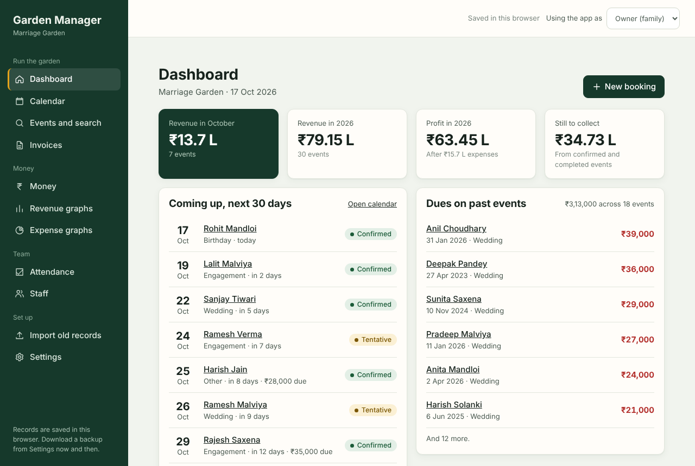
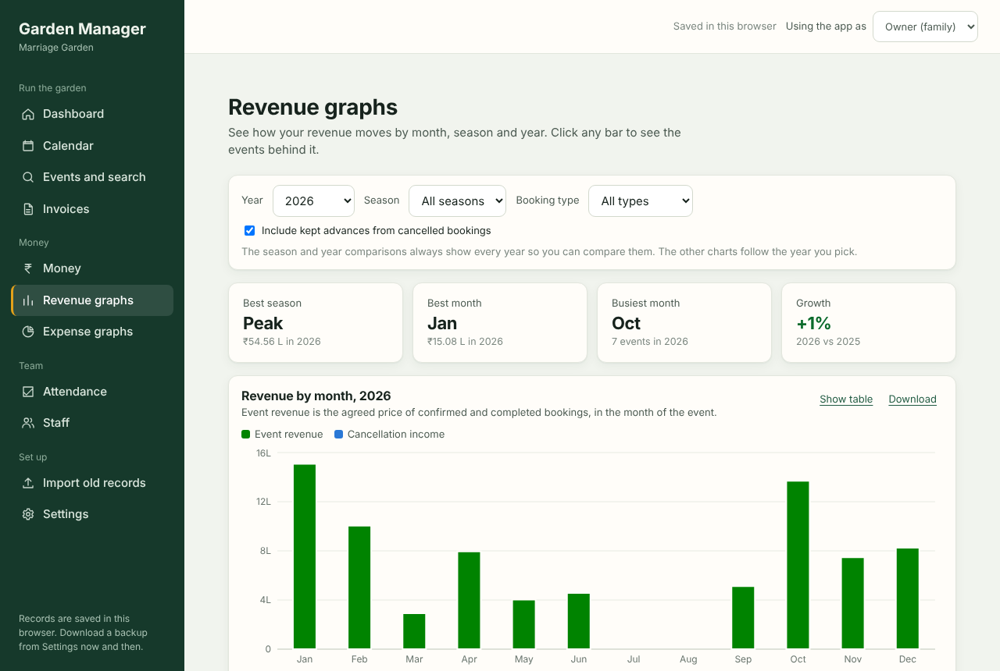
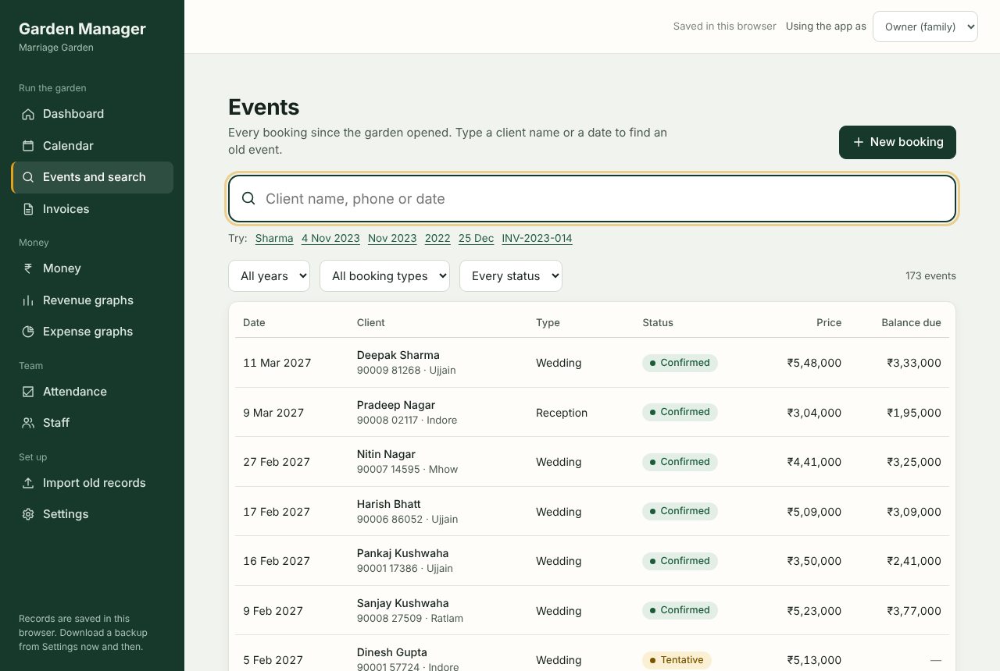
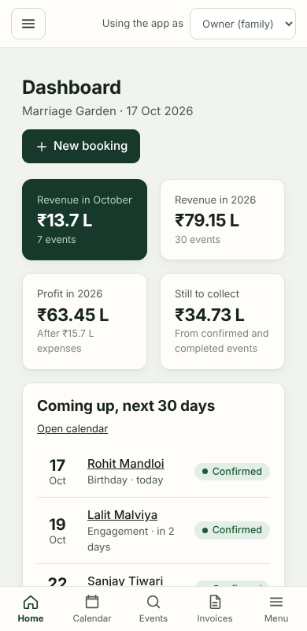
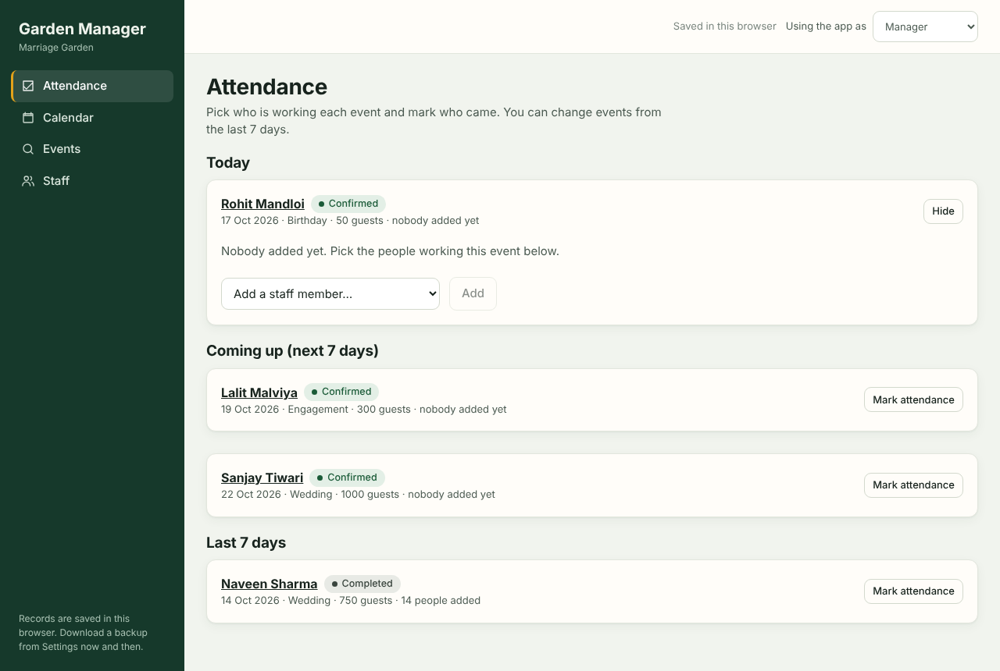

# Garden Manager

A private management app for a family-run marriage garden (wedding venue). It keeps every booking, client, payment and invoice in one place, shows revenue and profit, and lets the garden manager mark staff attendance without ever seeing money.

Built for one real business, designed to cost nothing to run: React front end, Firebase's free plan for sign-in and data, GitHub Pages for hosting.



| Revenue graphs | Search any old event |
|---|---|
|  |  |

| On a phone | Manager view (no money) |
|---|---|
|  |  |

The screenshots use made-up demo data. No real client information is in this repository.

## What it does
- **Bookings:** add and delete bookings, with Undo. Booking types (Wedding, Engagement, ...) are yours to add, rename and remove.
- **Find anything:** type a client name, phone number, invoice number, or a date like `4 Nov 2023`, `Nov 2023` or `2022`.
- **Invoices:** keep earlier years' invoices (PDF or photo) and add new ones, tied to the event.
- **Money:** revenue, pending dues, expenses and profit per event, month and year. Cancelled bookings keep their advance as revenue, and a cancellation is easy to undo or edit.
- **Graphs:** separate Revenue and Expense pages, by month, season, year and event type. You define the seasons.
- **Team:** the manager picks staff for an event day and marks attendance. Wages flow into profit.
- **Roles:** the owner sees everything. The manager sees bookings, client names, staff and attendance, and nothing about money. The database enforces this, not just the screen.
- **Old records:** import six years of history from a spreadsheet. Only a date and a client name are needed.
- **Backup:** one `.zip` with all records and every invoice file. Restore it any time.

## Two ways to run it

| | Try it | Use it for real |
|---|---|---|
| Data lives in | your browser | Firebase (free plan) |
| Sign-in | none | email and password |
| Several devices | no | yes, changes appear live |
| Setup time | 2 minutes | about 30 minutes, once |

### 1. Try it on your computer
You need [Node.js](https://nodejs.org) 20 or newer.

```
git clone https://github.com/<your-username>/garden-manager.git
cd garden-manager
npm install
npm run dev
```

Open http://localhost:5173. It starts with six years of invented events so you can try everything. "Using the app as" at the top switches between Owner and Manager. Settings, Your data, clears the demo records.

### 2. Use it for real (Firebase)
1. Follow **[FIREBASE_SETUP.md](FIREBASE_SETUP.md)**. It is click by click: create the project, turn on sign-in, create the database, paste the rules from [`firestore.rules`](firestore.rules), give each person a role.
2. Copy `.env.example` to `.env.local` and paste in the four values Firebase shows you.
3. Run `npm run dev` again. You now get a sign-in screen, and your records are online.

### 3. Put it online (GitHub Pages)
So the family and the manager can open it on their phones.

1. On github.com, create a **new public repository** named `garden-manager`. Do not tick "Add a README".
2. In this folder:
   ```
   git remote add origin https://github.com/<your-username>/garden-manager.git
   git push -u origin main
   ```
3. In the repository: **Settings > Pages > Build and deployment > Source: GitHub Actions**.
4. **Settings > Secrets and variables > Actions > Variables tab > New repository variable.** Add four variables with exactly these names and the values from Firebase: `VITE_FIREBASE_API_KEY`, `VITE_FIREBASE_AUTH_DOMAIN`, `VITE_FIREBASE_PROJECT_ID`, `VITE_FIREBASE_APP_ID`.
5. **Actions tab > Deploy to GitHub Pages > Run workflow.** When it turns green, your app is at `https://<your-username>.github.io/garden-manager/`.
6. In the Firebase console: **Authentication > Settings > Authorized domains > Add domain** `<your-username>.github.io`.

Every later `git push` to `main` redeploys. If you skip step 4, the site is published in "try it" mode with demo data and no sign-in, so do not skip it before sharing the link.

## Is it safe to keep this repository public?
Yes, as long as you follow two rules.

- **Never commit real data.** Records live in Firebase, not in this repository. Do not add backups, exports or photos of invoices to the folder. `.gitignore` already blocks `.env` files, `.zip` files and `garden-backup*`.
- **The four Firebase values are not secrets.** They end up inside the published website by design. What protects your data is sign-in plus the rules in `firestore.rules`: nobody without a role document can read anything. Turn off "Enable create (sign-up)" in Firebase so strangers cannot even make accounts (FIREBASE_SETUP.md, section 2, point 5).

## Costs
Everything here fits Firebase's free Spark plan (1 GiB stored, 50,000 reads and 20,000 writes a day) and free GitHub Pages hosting for public repositories. No card is needed anywhere. Invoice files are stored inside the database (photos are shrunk automatically, PDFs up to 3 MB), which is why no paid file storage is needed. If you need bigger files later, Firebase Storage works but requires a card.

## How it is built
```
src/
  lib/calc.js, analytics.js     the money rules and graph data (money is whole paise, never decimals)
  lib/reducer.js                every change to the data, in one place
  lib/search.js                 name, phone, date and invoice search
  lib/sync.js, writeQueue.js    turns changes into small writes, retries when offline
  lib/split.js                  the fields the manager must never receive
  lib/backends/                 browser, Firestore, files-in-Firestore, and a fake one for tests
  lib/backup.js, zip.js         zip backup and restore, no library
  components/, pages/           the screens
firestore.rules                 the database rules
scripts/check-calc.mjs          a long list of checks, run by `npm run check` and before every deploy
```
The screens never talk to a database. They talk to the store, which talks to a backend, so the data can live in the browser or in Firebase without any screen changing.

## Testing
`npm run check` runs the tests: money rules, search, cancellations, delete and Undo, import, the sync layer, two devices staying in step, manager privacy and the database rules, invoice files and the zip backup. The online parts run against a pretend Firestore (`scripts/fake-firestore.mjs`), so they need no internet.

## Honest limits
- It has not been run against a live Firebase project by its author yet; the online parts are tested against a simulated database. Report anything that behaves differently.
- A PDF over 3 MB is refused online. Rescan at lower quality or photograph the page.
- Two people editing the same record at the same moment: the later save wins.
- A manager's attendance marks get their wage worked out the next time an owner has the app open.

## Project notes
Planning and decision documents: [`CLAUDE.md`](CLAUDE.md), [`SESSION_HANDOFF.md`](SESSION_HANDOFF.md), [`REQUIREMENTS.md`](REQUIREMENTS.md), [`DESIGN.md`](DESIGN.md), [`ARCHITECTURE.md`](ARCHITECTURE.md).

## Licence
MIT. See [LICENSE](LICENSE).
